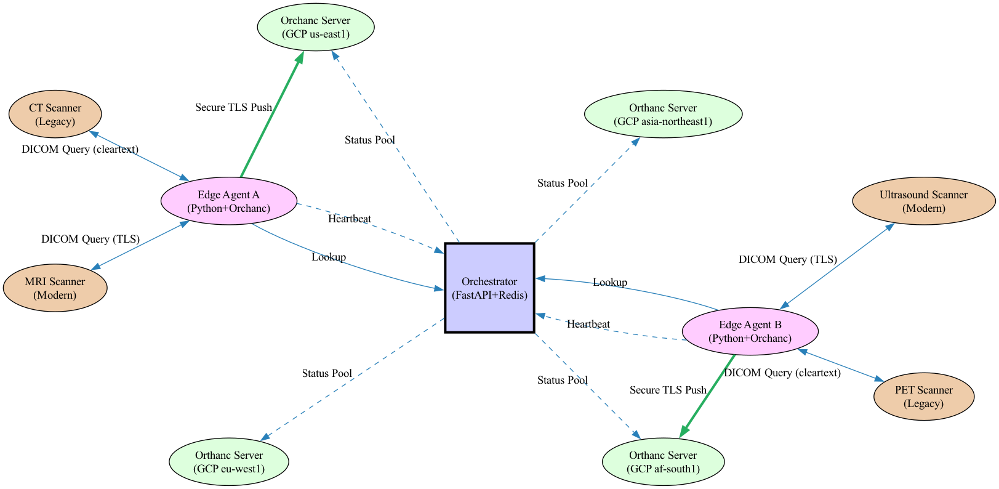

# Diomede: Dynamic DICOM Endpoint Routing

**Diomede** is a telemetry-driven orchestration and edge-forwarding
system that replaces static DICOM endpoint configurations with dynamic,
load-aware routing across distributed cloud PACS nodes.

Conventional DICOM deployments bind each modality to a fixed
`{IP, port, AE Title}` destination compiled into scanner firmware or legacy
routing tables. When a target PACS node becomes overloaded, its wide-area link
degrades, or its disk fills, static transfers stall until an operator intervenes
manually while regional peers sit idle. Diomede addresses this bottleneck by
continuously monitoring Orthanc job queues, live in-flight ingestion load,
storage headroom, and per-edge network latency across every registered node,
routing each incoming study to the optimal policy-compliant destination.



Local scanners send standard DIMSE `C-STORE` studies to a co-located **Edge
Agent** (Orthanc + Python Forwarder), which queries the **Orchestrator**
(FastAPI + Redis) for the highest-scoring healthy, jurisdiction-compliant cloud
Orthanc node and forwards the study directly over TLS using a selectable
transport: native mutual-TLS DIMSE `C-STORE` with IHE RAD-10 DICOM Storage
Commitment, DICOMweb `STOW-RS`, or zero-copy streaming REST. Redis-backed atomic
study affinity and optional study-level commit prevent multi-slice examinations
from splitting across nodes during failover, while a durable study location
index tracks where routed studies reside.

---

## Where to start

Follow in this order:

1. **This README**: what Diomede is and how to run it.
2. **[Setup guide](docs/setup.md)**: the full, step-by-step walkthrough.
3. **[Architecture](docs/architecture.md)**: internal design covering the
   routing lifecycle, scoring algorithm, study affinity, and dead-node detection.
4. **[Contributing](CONTRIBUTING.md)**: branch/PR workflow, pre-commit hooks,
   PHI-safe logging policy, and test strategy.

---

## Repository layout

| Path | What lives here |
|---|---|
| `src/orchestrator/` | FastAPI orchestrator (`main.py`), Telemetry Daemon (`daemon.py`), pluggable scorers (`scorer.py`, `weighted_scorer.py`, `baseline_scorers.py`) |
| `src/edge/` | Forwarder Daemon (`forwarder.py`), Orthanc edge source (`orthanc_source.py`), transport interface (`transport.py`), and destination protocols (`destinations.py`: DIMSE + Storage Commitment, STOW-RS, REST) |
| `src/simulator/` | Synthetic DICOM senders (`send_dicom_native.py`, `send_dicom_rest.py`) and generator (`generate_dicom.py`) |
| `src/benchmark/` | Reproducible benchmarks for routing correctness, failover, success rate, comparative baselines, sensitivity analysis, link degradation, storage exhaustion, and clinical integrity |
| `src/utils/` | Shared helpers: node registry (`nodes.py`), Orthanc config renderer (`render_orthanc_config.py`), clinical integrity verifier (`verify_pipeline.py`), environment and logging utilities |
| `config/` | Declarative cloud node registry (`nodes.json`), container build contexts (`edge/`, `orchestrator/`), Orthanc config templates (`orthanc/*.template.json`), and HAProxy baseline config (`haproxy/`) |
| `scripts/` | `gen_certs.sh` (CA + dual-EKU TLS certs), `inject_latency.sh` (`tc netem` WAN shaping), and `simulate_partition.sh` (network partition testing) |
| `tests/` | `unit/`, `integration/`, and `load/` (Locust) suites |
| `docs/` | `setup.md`, `architecture.md`, and diagrams |

---

## Quick start

**Requires** Docker Compose v2 and Python 3.12+.

```bash
# 1. Configuration: copy the template
cp .env.example .env
#    then edit .env and replace every CHANGE_IN_PRODUCTION
#    (ORTHANC_PASSWORD and ORCHESTRATOR_API_KEY)

# 2. TLS: every REST/DICOM link runs over TLS, so generate the CA + node certs first
bash scripts/gen_certs.sh

# 3. Start the 4 regional Orthanc nodes (pre-built image), wait until healthy
docker compose up -d orthanc-us orthanc-eu orthanc-asia orthanc-af
docker compose ps

# 4. Build and start the orchestrator + edge agent (local Dockerfiles)
docker compose up -d --build orchestrator agent-001

# 5. Verify all 8 containers are healthy, then query the orchestrator for the best node
docker compose ps
curl -k -H "X-API-Key: <your_api_key>" \
  "https://localhost:8000/get-best-node?agent_id=agent-001" | python3 -m json.tool
```

> The orchestrator serves **HTTPS** with a self-signed certificate, so `-k`
> skips hostname verification for local calls. All control-plane endpoints
> require the `X-API-Key` header matching `ORCHESTRATOR_API_KEY` in `.env`.

Full walkthrough, including sending test DICOM studies, WAN latency injection,
and failover testing, is in the **[setup guide](docs/setup.md)**.

---

## Development

Unit tests and linting run on the host without Docker.

```bash
python3 -m venv .venv && source .venv/bin/activate
pip install -e ".[orchestrator,edge,scripts,test,dev]"   # add ,load for load tests

# Unit tests
python -m pytest tests/unit/ -v -m unit --cov=src --cov-fail-under=80

# Lint + format check
ruff check src/
ruff format --check src/

# Type check (run from the repo root, as CI does)
for src_dir in src/orchestrator src/edge src/simulator; do
  mypy "$src_dir"
done
```

Integration tests (`pytest tests/integration/ -v -m integration`) require the
full stack to be running. The orchestrator and edge images bake in `src/`, so
rebuild the affected service after code edits:
`docker compose up -d --build orchestrator agent-001`.

See **[Contributing](CONTRIBUTING.md)** for pre-commit hooks and scoring-weight
tuning.

---

## Documentation

| Document | Description |
|---|---|
| [Setup guide](docs/setup.md) | Fresh clone to running stack, test transfers, WAN latency, failover, tests |
| [Architecture](docs/architecture.md) | System design, routing lifecycle, scoring algorithm, dead-node detection, security |
| [Contributing](CONTRIBUTING.md) | Development workflow, pre-commit hooks, PHI-safe logging, test strategy |

---

## Acknowledgements

This project was developed with support from [Google Summer of Code (GSoC) 2026](https://summerofcode.withgoogle.com/)
at the [KathiraveluLab, University of Alaska Anchorage](https://github.com/KathiraveluLab).
