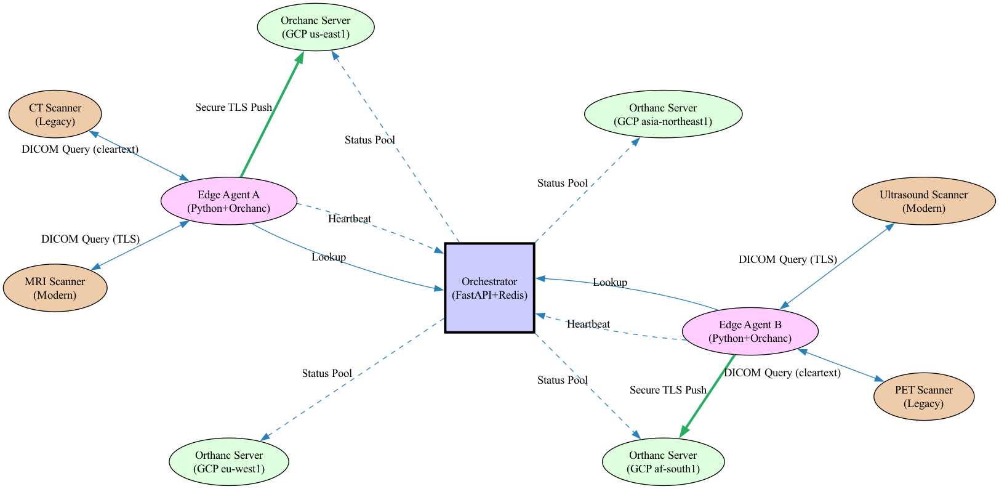

# Diomede — Dynamic DICOM Endpoint Routing

A [GSoC 2026](https://summerofcode.withgoogle.com/) project built with the
[KathiraveluLab @ University of Alaska Anchorage](https://github.com/KathiraveluLab)
that replaces static DICOM endpoint configuration with an intelligent,
self-healing routing mesh across regional cloud PACS nodes.

Every DICOM connection today is identified by a fixed `{IP, port, AE Title}`
triple compiled into scanner firmware. When the destination node is overloaded,
its network link degrades, or its disk fills, there is no mechanism to redirect
traffic. Studies queue, radiologists wait, and in time-critical scenarios
delays have clinical consequences. Meanwhile, nodes in other regions sit idle.
Diomede solves this by continuously monitoring queue depth, disk space, and
round-trip latency across every registered Orthanc node and routing each
incoming study to the optimal destination in milliseconds.



An edge site sends DICOM studies to a local **Forwarder Daemon**, which queries
the **Orchestrator** for the lowest-cost cloud node and posts the bytes there
directly. The Orchestrator scores all nodes registered in Redis and
automatically excludes any node whose heartbeat TTL has expired.

---

## Where to start

Follow in this order:

1. **This README** — what Diomede is.
2. **[Setup guide](docs/setup.md)** — the full, step-by-step walkthrough.
3. **[Architecture](docs/architecture.md)** — how it works internally: the routing
   lifecycle, scoring algorithm, and dead-node detection.
4. **[Contributing](CONTRIBUTING.md)** — branch/PR workflow, pre-commit hooks, and
   test strategy.

---

## Repository layout

| Path | What lives here |
|---|---|
| `src/orchestrator/` | FastAPI orchestrator (`main.py`), Telemetry Daemon (`daemon.py`), pluggable scorer (`scorer.py`, `weighted_scorer.py`) |
| `src/edge/` | Forwarder Daemon (`forwarder.py`), polls the edge Orthanc and routes new instances |
| `src/simulator/` | Synthetic DICOM senders (`send_dicom_native.py`, `send_dicom_rest.py`) and generator (`generate_dicom.py`) |
| `src/utils/` | Shared helpers (logging config, etc.) |
| `config/` | Container build context: `Dockerfile`s, `start.sh` entrypoints, and Orthanc config templates (`config/orthanc/*.template.json`) |
| `scripts/` | `gen_certs.sh` (TLS CA + per-node certs) and `inject_latency.sh` (WAN latency simulation) |
| `tests/` | `unit/`, `integration/`, `load/`|
| `docs/` | `setup.md`, `architecture.md`, and diagrams |

---

## Quick start

**Requires** Docker Compose v2 and Python 3.12+.

```bash
# 1. Configuration, copy the template
cp .env.example .env
#    then edit .env and replace every CHANGE_IN_PRODUCTION
#    (ORTHANC_PASSWORD and ORCHESTRATOR_API_KEY)

# 2. TLS, every REST/DICOM link runs over TLS, so generate the CA + node certs first
bash scripts/gen_certs.sh

# 3. Start the 4 regional Orthanc nodes (pre-built image), wait until healthy
docker compose up -d orthanc-us orthanc-eu orthanc-asia orthanc-af
docker compose ps

# 4. Build and start the orchestrator, telemetry daemon and edge agent (local Dockerfiles)
docker compose up -d --build orchestrator telemetry-daemon agent-001

# 5. Verify all 8 containers healthy, then ask the orchestrator for the best node
docker compose ps
curl -k -H "X-API-Key: <your_api_key>" \
  "https://localhost:8000/get-best-node?agent_id=agent-001" | python3 -m json.tool
```

> The orchestrator serves **HTTPS** with a self-signed cert, so `-k` skips
> hostname verification for local calls. All endpoints require the `X-API-Key`
> header matching `ORCHESTRATOR_API_KEY` in your `.env`.

Full walkthrough, including sending test DICOM studies, WAN latency injection,
and failover testing, is in the **[setup guide](docs/setup.md)**.

---

## Development

Unit tests and linting run entirely on your host.

```bash
python3 -m venv .venv && source .venv/bin/activate
pip install -e ".[orchestrator,edge,scripts,test,dev]"   # add ,load for load tests

# Unit tests
python -m pytest tests/unit/ -v -m unit --cov=src --cov-fail-under=80

# Lint + format check
ruff check src/
ruff format --check src/

# Type check — each service dir is checked from inside it, mirroring runtime imports
for src_dir in src/orchestrator src/edge src/simulator; do
  (cd "$src_dir" && mypy .)
done
```

Integration tests (`pytest tests/integration/ -v -m integration`) require the full
stack to be running. The orchestrator and edge images **bake in** `src/`, so after
editing that code rebuild the affected containers:
`docker compose up -d --build orchestrator telemetry-daemon agent-001`.

See **[Contributing](CONTRIBUTING.md)** for pre-commit hooks and scoring-weight tuning.

---

## Documentation

| Document | Description |
|---|---|
| [Setup guide](docs/setup.md) | Fresh-clone → running stack, test transfers, WAN latency, failover, tests |
| [Architecture](docs/architecture.md) | System design, routing lifecycle, scoring algorithm, dead-node detection, security |
| [Contributing](CONTRIBUTING.md) | Development workflow, pre-commit hooks, test strategy |
